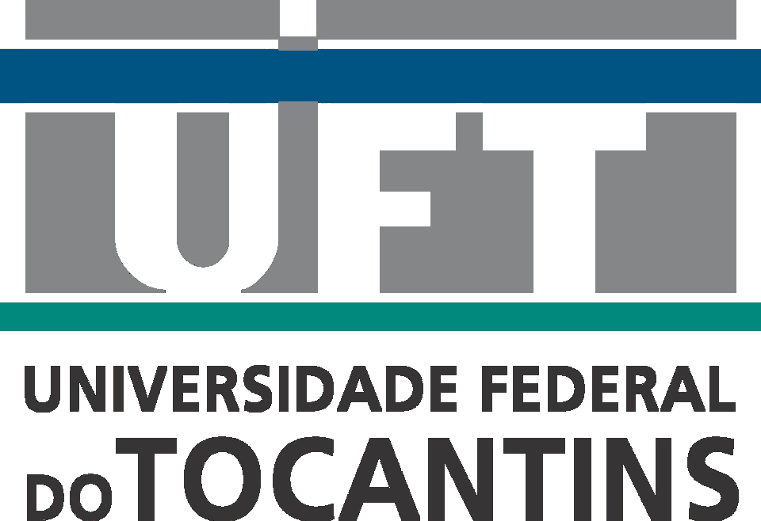
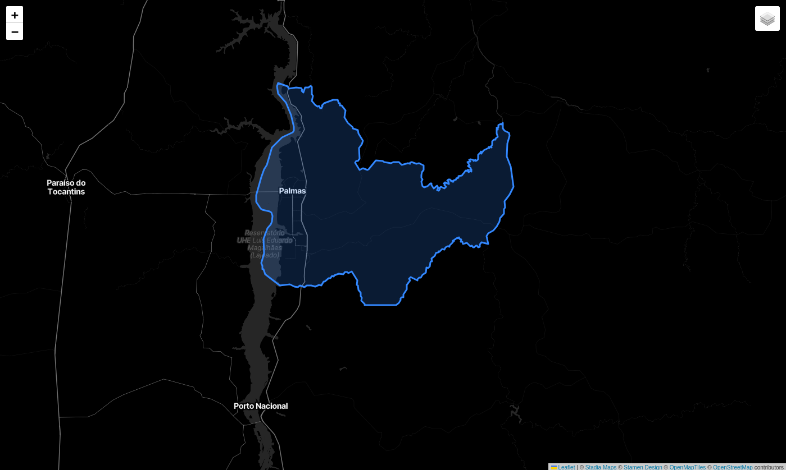

<div align="center">



<h1>Constructo</h1>
<p><strong>Construindo uma gestão mais clara.</strong></p>
<p>Gestão integrada de obras, contratos, medições e evidências de execução.</p>

</div>

---

## 👥 Equipe

- [José Carlos da Silva Neto](https://github.com/jcarlos721)
- [Eduardo Lopes de Oliveira Torres](https://github.com/EduLps1)
- [Pedro Ryan Oliveira de Almeida](https://github.com/PdroRyan)
- [Ricardo Lopes Tomaz](https://github.com/ricardolopestomaz)
- [Samuel Andrade Luz Carneiro](https://github.com/Samuel1-salc)
- [Matheus Henrique de Freitas](https://github.com/MatheusHFreitas)

---

## 🎓 Informações acadêmicas

| Informação | Descrição |
| --- | --- |
| Instituição | Universidade Federal do Tocantins (UFT) |
| Curso | Bacharelado em Ciência da Computação |
| Grupo | 7 — Constructo |
| Disciplina | Desenvolvimento Webmobile |
| Professor | Jackson Gomes de Souza |
| Disciplina associada à proposta de startup | Projeto de Sistemas |
| Professor de Projeto de Sistemas | Edeilson Milhomem |
| Semestre | 2026.2 |

---

## 🏗️ Sobre o produto

O **Constructo** é uma plataforma web e mobile voltada à centralização do planejamento e do acompanhamento de obras, contratos e medições. A solução busca oferecer às construtoras informações organizadas para apoiar decisões gerenciais e proporcionar aos compradores de imóveis maior transparência sobre a evolução de seus empreendimentos.

A plataforma integra cronogramas, metas, indicadores de desempenho, documentos, evidências fotográficas e audiovisuais e informações geoespaciais em um ambiente de acompanhamento rastreável.

Por meio da aplicação web, gestores poderão administrar as informações da obra. A aplicação mobile permitirá que equipes de campo registrem evidências diretamente do canteiro e que clientes acompanhem as atualizações publicadas sobre seus imóveis.

---

## 🎯 Problema

O acompanhamento de empreendimentos frequentemente depende de planilhas, contratos, relatórios, documentos técnicos, registros fotográficos e comunicados distribuídos em diferentes ferramentas.

Essa fragmentação dificulta:

- Acompanhar marcos, prazos e metas de execução;
- Relacionar medições e etapas da obra às obrigações contratuais;
- Identificar desvios entre o planejamento e o avanço físico;
- Organizar evidências e identificar a origem das informações;
- Comunicar o progresso aos compradores e investidores;
- Reduzir a necessidade de visitas presenciais exclusivamente para consultar o andamento da obra.

## 💡 Solução proposta

O Constructo propõe uma experiência integrada de gestão, desde a definição do planejamento até a publicação de evidências de execução para os clientes.

<div align="center">
<strong>Planejamento → execução → medição → evidência → validação → publicação</strong>
</div>

A solução também prevê uma interface territorial, por meio do módulo DOMINUS, para consultar a situação das obras e navegar até os indicadores e documentos correspondentes.

---

## 👤 Público-alvo

| Segmento | Necessidade atendida |
| --- | --- |
| Construtoras, executoras e incorporadoras | Centralização de informações, controle de cronogramas, contratos, metas e medições. |
| Gestores, engenheiros e equipes de campo | Organização das etapas, registro de evidências e acompanhamento operacional. |
| Compradores de imóveis | Consulta transparente e remota da evolução do empreendimento e de sua unidade. |
| Investidores | Acompanhamento das informações disponibilizadas sobre o empreendimento, conforme as permissões de acesso. |

O foco comercial primário são as empresas do setor da construção. Os compradores constituem um segmento de usuários finais atendido pela solução.

## 💎 Proposta de valor

### Para executoras e incorporadoras

- Centralizar dados de planejamento, contratos e execução;
- Apoiar decisões com indicadores e medições organizados;
- Melhorar a comunicação e a confiança dos clientes;
- Reduzir interrupções das equipes técnicas decorrentes de visitas de acompanhamento;
- Facilitar a comprovação do progresso por meio de evidências vinculadas às etapas da obra.

### Para compradores de imóveis

- Consultar o progresso do empreendimento pelo celular ou computador;
- Acompanhar etapas e evidências visuais publicadas;
- Obter maior clareza sobre a evolução do investimento;
- Diminuir a necessidade de deslocamento até o canteiro para acompanhar a execução.

## 🤝 Possíveis parceiros

- **Construtoras e incorporadoras privadas:** organizações interessadas em eficiência operacional e relacionamento com clientes. Exemplos de referência: MRV, FAMA Empreendimentos e Urban.
- **Gestores de obras públicas:** responsáveis por empreendimentos governamentais e de infraestrutura que demandam rastreabilidade, documentação técnica e prestação de contas.

> Os nomes apresentados são referências de potenciais parceiros, não parcerias formalizadas.

---

## 🚀 Principais recursos

| Recurso | Finalidade |
| --- | --- |
| Planejamento personalizado | Definir marcos e cronogramas adequados a cada obra. |
| Gestão de metas e indicadores | Acompanhar objetivos e desempenho da execução. |
| Gestão contratual | Relacionar etapas e acompanhamento aos termos estabelecidos nos contratos. |
| Gestão de medições | Registrar e acompanhar o avanço físico da obra. |
| Gestão centralizada | Reunir informações operacionais em uma plataforma integrada. |
| Evidências visuais | Padronizar registros de fotos e vídeos de execução. |
| Taxonomia estrutural | Organizar informações por empreendimento, obra, torre, pavimento e unidade. |
| Feed mobile da construtora | Registrar evidências e atualizações diretamente do canteiro. |
| Feed mobile do cliente | Consultar avanços e evidências publicadas sobre o empreendimento. |
| DOMINUS | Consultar obras e indicadores por meio de representação geoespacial. |

---

## 📦 Escopo da entrega acadêmica

Os módulos abaixo representam o escopo funcional planejado, não uma declaração de funcionalidades já implementadas.

> [!IMPORTANT]
> A visualização tridimensional de imóveis e empreendimentos, incluindo processamento e renderização de modelos GLB, glTF, BIM ou IFC, permanece fora da entrega acadêmica atual.

### 1. Autenticação, autorização e usuários

- Autenticação e autorização de acesso;
- Gestão de perfis e permissões;
- Controle de acesso às funcionalidades e informações conforme o perfil do usuário.

### 2. Gestão da estrutura dos empreendimentos

Organização hierárquica de construtoras, empreendimentos, obras, torres, pavimentos e unidades. A taxonomia estrutural servirá de referência para associar contratos, etapas, medições, documentos e evidências.

### 3. Gestão administrativa das obras

Cadastro, edição e acompanhamento dos dados das obras por usuários autorizados, com uma visão centralizada da execução e de sua estrutura.

### 4. Planejamento, cronogramas e metas

- Criação de marcos e etapas personalizados;
- Definição de prazos e metas de execução;
- Acompanhamento do progresso em relação ao planejamento;
- Consulta de indicadores de desempenho.

### 5. Gestão de contratos e medições

- Cadastro e acompanhamento de informações contratuais;
- Associação das etapas da obra aos termos estabelecidos;
- Registro de medições e acompanhamento do avanço físico;
- Vinculação de documentos e evidências às informações de execução, quando aplicável.

### 6. Atualizações, aprovação e publicação

O fluxo de atualização deverá separar o registro, a validação pelo responsável, a aprovação e a publicação das informações. O objetivo é evitar que dados não validados sejam apresentados como informações oficiais.

### 7. Fotos, vídeos, documentos e evidências

- Fotografias e vídeos de acompanhamento;
- Plantas, relatórios, planilhas e documentos técnicos;
- Associação de arquivos a atualizações e etapas da obra;
- Registro padronizado de evidências para comprovação do progresso.

### 8. Timeline, feed de campo, comunicados e notificações

A aplicação mobile da construtora deverá permitir o registro de atualizações e evidências diretamente do canteiro. A linha do tempo reunirá avanços, alterações relevantes, comunicados e notificações conforme as permissões e o fluxo de publicação.

### 9. Módulo Meu Apê — feed do cliente

Os clientes poderão ser vinculados às suas unidades para consultar a evolução do empreendimento, acompanhar etapas e acessar as evidências visuais e demais informações autorizadas e publicadas pela construtora.

A visualização tridimensional permanecerá fora do escopo atual.

### 10. Auditoria e histórico

As alterações relevantes deverão manter registros sobre o que foi alterado, quando, por quem e qual era o estado anterior, quando aplicável.

### 11. Isolamento entre construtoras

A aplicação deverá impedir o acesso indevido a dados de outras organizações, respeitando os vínculos e permissões de cada usuário.

### 12. DOMINUS — Inteligência territorial da obra

O **DOMINUS** será o módulo geoespacial responsável por representar obras e áreas de interesse no território, utilizando **GeoJSON** para associar regiões geográficas às informações de acompanhamento.

<div align="center">

</div>

Ao selecionar uma obra no mapa, o usuário poderá consultar uma visão resumida de sua situação, incluindo indicadores de:

- Progresso físico e cronograma;
- Custos e desvios financeiros;
- Produtividade e qualidade da execução;
- Riscos, ocorrências e situação geral.

Quando aplicável, os indicadores poderão ser vinculados a planilhas, relatórios, documentos técnicos e evidências visuais.

<div align="center">
<strong>Território → obra → situação → indicador → evidência</strong>
</div>

O DOMINUS complementa a gestão operacional e contratual, oferecendo uma interface territorial de consulta às informações dos demais módulos.

---

## 🧱 Aplicações e monorepo

O Constructo é organizado em um monorepo pnpm com aplicações web e mobile:

```text
apps/web     → aplicação web React + Vite
apps/mobile  → aplicação mobile React Native + Expo
```

O backend Django REST Framework está previsto na arquitetura e será adicionado como serviço separado quando sua implementação começar.

### Pré-requisitos

- Node.js 22.22 ou superior;
- pnpm 11.21.0, preferencialmente ativado por Corepack.

### Instalação e execução

Execute os comandos na raiz do repositório:

```bash
pnpm install
pnpm dev:web
pnpm dev:mobile
pnpm check
```

Copie o `.env.example` de cada aplicativo para `.env.local` quando precisar configurar a URL da API.

---

## 📚 Documentação

1. **README.md** — visão do produto, proposta de valor e entregáveis acadêmicos;
2. **[ARCHITECTURE.md](docs/ARCHITECTURE.md)** — organização do monorepo e regras entre camadas;
3. **[ORIENTACOES.md](docs/ORIENTACOES.md)** — convenções práticas de desenvolvimento;
4. **[STACK_TECNOLOGICA.md](docs/STACK_TECNOLOGICA.md)** — tecnologias adotadas e papel de cada componente;
5. **[EVOLUCAO_FUTURA.md](docs/EVOLUCAO_FUTURA.md)** — recursos planejados para depois da entrega acadêmica.
