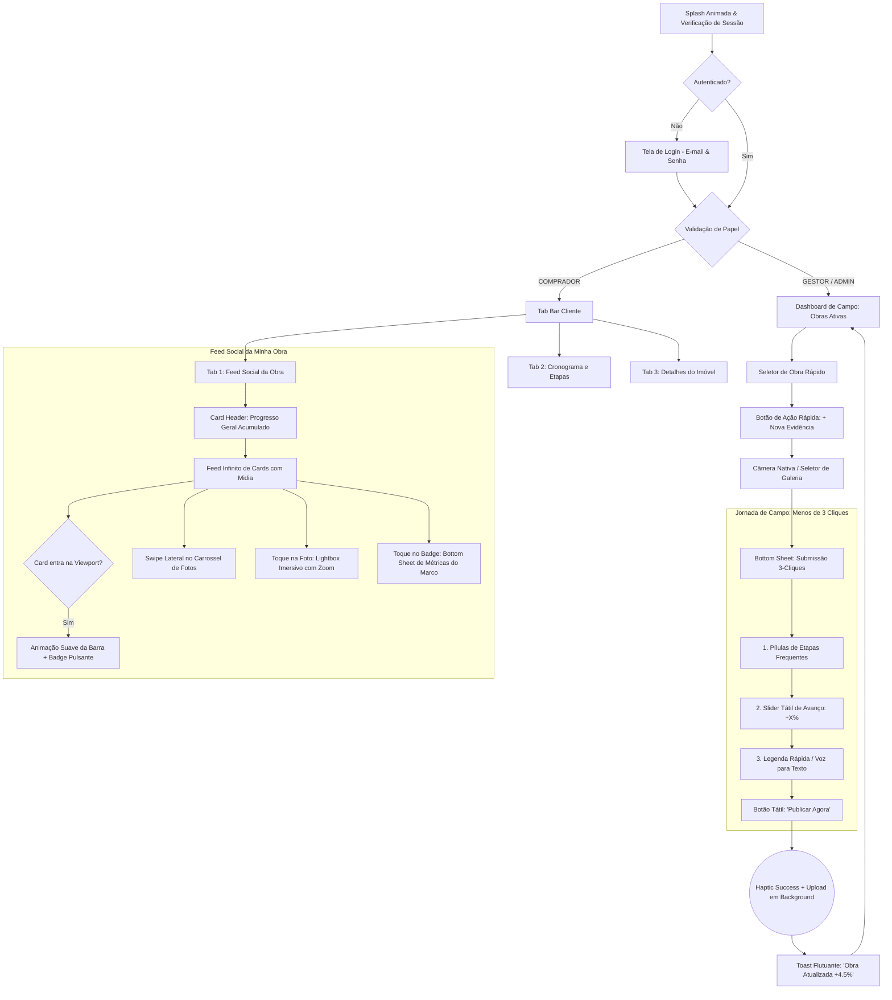

# 03. Blueprint de UX/UI & Diretrizes de Design Tátil (Anti-AI Craft)

**Documento:** `/docs/mobile-spec/03-ui-ux-blueprint.md`  
**Status:** Aprovado para Arquitetura & Planejamento  
**Lead Designer & Front-End Mobile Architect:** Staff Engineer  
**Data:** Outubro de 2026  
**Diretriz de Design:** Conforme `.agents/skills/ui-craft/SKILL.md` (Anti-AI Slop • Tátil • Industrial Mineral)  

---

## 1. Fluxograma Geral de Navegação (Mermaid.js)

O fluxo do aplicativo mobile é bifurcado na raiz de acordo com o papel do usuário autenticado (`papel: GESTOR` vs. `papel: COMPRADOR`), garantindo jornadas limpas e sem poluição de contexto.



---

## 2. Design System & Tokens Oficiais do Constructo

O Constructo adota a estética **Industrial Mineral**: limpa, de altíssimo contraste, robusta e imersiva, eliminando totalmente vícios visuais de inteligência artificial (como degradês genéricos azul/roxo e sombras borradas).

### 2.1. Tokens de Cores Semânticas

| Token | Código HEX | Aplicação no Mobile |
| :--- | :--- | :--- |
| **`fundo-painel`** | `#F5F7F6` | Fundo principal de todas as telas (off-white mineral). |
| **`superficie`** | `#FFFFFF` | Fundo elevado dos cards, bottom sheets e inputs. |
| **`superficie-sutil`**| `#F8FAF9` | Fundo de badges inativos, sliders e cabeçalhos de tabela. |
| **`primaria`** | `#236557` | **Verde Floresta Industrial**: Botões principais, indicadores de sucesso e barras de progresso ativas. |
| **`primaria-hover`** | `#194F45` | Estado pressionado de botões e links. |
| **`destaque`** | `#B97200` | **Âmbar / Ocre de Obra**: Badges de impacto (`+4.5%`), marcos entregues e alertas visuais. |
| **`borda`** | `#DFE5E3` | Bordas nítidas de 1px em todos os cards e campos de entrada. |
| **`borda-foco`** | `#B9CDC7` | Borda em inputs focados e cards selecionados. |
| **`texto-forte`** | `#0F172A` | Títulos e números grandes (Preto Profundo / Ardósia). |
| **`texto`** | `#263B37` | Parágrafos de legendas técnicas e descrições de posts. |
| **`texto-suave`** | `#62706D` | Datas relativas, cargos e metadados secundários. |

### 2.2. Raios e Camadas de Sombra Tátil (Elevations)

- **Raios Padrão:**
  - `radiusField`: `10px` (inputs de texto, pílulas de filtro e botões secundários).
  - `radiusButton`: `14px` (botões de ação primária de polegar).
  - `radiusCard`: `20px` (cards de postagem do feed e card de resumo).
  - `radiusSheet`: `28px` (borda superior das Bottom Sheets deslizantes).
- **Elevações Táteis (Multi-layer crisp shadows):**
  - *Evitar `shadowRadius > 10` sem nitidez.*
  - **Cards Estáticos (`elevation-1`):**
    ```javascript
    shadowColor: '#0F172A',
    shadowOffset: { width: 0, height: 2 },
    shadowOpacity: 0.04,
    shadowRadius: 6,
    elevation: 2,
    borderWidth: 1,
    borderColor: '#DFE5E3'
    ```
  - **Cards Flutuantes / Sheets (`elevation-2`):**
    ```javascript
    shadowColor: '#0F172A',
    shadowOffset: { width: 0, height: 8 },
    shadowOpacity: 0.08,
    shadowRadius: 18,
    elevation: 8,
    borderWidth: 1,
    borderColor: '#DFE5E3'
    ```

---

## 3. Física de Micro-interações & Haptics

Para garantir a sensação de aplicativo artesanal (*high-craft*), o app obedece a regras de física em tempo real:

1. **Reação Física ao Toque (*Squishy Button Effect*):**
   - Todo botão e card clicável utiliza `react-native-reanimated` com mola amortecida:
   - Ao pressionar (`onPressIn`): `scale.value = withSpring(0.96, { damping: 15, stiffness: 300 })`.
   - Ao soltar (`onPressOut`): `scale.value = withSpring(1.0, { damping: 15, stiffness: 300 })`.
2. **Entrada em Cascata (*Staggered Fade-In*):**
   - Listas e cards entram na tela com animação escalonada:
   - `FadeInDown.delay(index * 45).springify().damping(16)`.
3. **Feedback Háptico Tátil (`expo-haptics`):**
   - Toque em botões simples: `Haptics.impactAsync(Haptics.ImpactFeedbackStyle.Light)`.
   - Mudança de marco no slider de progresso: `Haptics.impactAsync(Haptics.ImpactFeedbackStyle.Medium)`.
   - Confirmação de publicação de evidência: `Haptics.notificationAsync(Haptics.NotificationFeedbackType.Success)`.

---

## 4. Especificação Cirúrgica das Telas

### 4.1. Visão Empresa: Tela de Submissão Rápida ("Zero-Friction")

Projetada especificamente para o uso sob luz solar direta e operação com apenas uma mão.

```
┌────────────────────────────────────────────────────────┐
│ [←] Obra: Residencial Parque das Águas                 │
├────────────────────────────────────────────────────────┤
│                                                        │
│  ┌──────────────────────────────────────────────────┐  │
│  │                                                  │  │
│  │             [ PRÉVIA DA FOTO CAPTURADA ]         │  │
│  │             (Proporção 4:3 com cantos 16px)      │  │
│  │                                                  │  │
│  │  [ 🔄 Trocar Foto ]        [ 🏷️ 14/10 14:32 ]   │  │
│  └──────────────────────────────────────────────────┘  │
│                                                        │
│  Etapa Atual da Obra:                                  │
│  ┌───────────────┐ ┌────────────────┐ ┌──────────────┐ │
│  │ ● Fundação    │ │ [● Estrutura]  │ │ ○ Alvenaria  │ │
│  └───────────────┘ └────────────────┘ └──────────────┘ │
│                                                        │
│  Quanto essa evidência avançou no projeto total?       │
│  ┌──────────────────────────────────────────────────┐  │
│  │   +4.5%                                          │  │
│  │   ━━━━━━━●────────────────────────────────────   │  │
│  │   [+1%]    [+2.5%]    [+5%]    [+10%]    [+20%]  │  │
│  └──────────────────────────────────────────────────┘  │
│                                                        │
│  Legenda Técnica / Descrição do Post:                  │
│  ┌──────────────────────────────────────────────────┐  │
│  │ Concretagem do 3º pavimento finalizada com teste │  │
│  │ de rompimento aprovado...                        │  │
│  └──────────────────────────────────────────────────┘  │
│                                                        │
│  [X] Publicar imediatamente no feed dos clientes       │
│                                                        │
│  ┌──────────────────────────────────────────────────┐  │
│  │           🚀 PUBLICAR EVIDÊNCIA AGORA            │  │
│  │           (Verde Floresta #236557 • 56px)        │  │
│  └──────────────────────────────────────────────────┘  │
└────────────────────────────────────────────────────────┘
```

#### Anatomia e Componentes:
1. **Header Fixo:** Título do empreendimento atual com chevron para troca rápida caso o engenheiro gerencie mais de uma obra.
2. **Card de Mídia Hero:** Foto recém-capturada com cantos de `16px`, botão flutuante de refazer captura e etiqueta de geolocalização/horário.
3. **Pílulas de Etapas Rápidas (Horizontal Scroll):** Pílulas táteis exibindo as 5 etapas ativas da taxonomia. A etapa selecionada ganha borda verde `#236557`, fundo `#F8FAF9` e fonte em peso 600.
4. **Seletor de Delta de Progresso:**
   - Display numérico grande em `#0F172A` (ex.: `+4.5%`).
   - Slider com marcas de parada táteis (*notches*).
   - Barra de atalhos rápidos com botões tipo pílula (`+1%`, `+2.5%`, `+5%`, `+10%`, `+20%`) que ajustam o valor com um único toque.
5. **Campo de Legenda Inteligente:** Input multi-linhas com suporte nativo a ditado por voz do teclado do smartphone.
6. **Switch de Publicação Social:** Toggle nativo com rótulo amigável: *"Disponibilizar no feed dos compradores"*.
7. **Botão de Ação Primária Flutuante:** Altura de `56px`, cor `#236557`, texto branco em caixa alta com peso bold, com física de mola ao pressionar.

---

### 4.2. Visão Cliente: Feed Social da Obra ("Timeline de Impacto")

A experiência visual do cliente é inspirada no dinamismo do Instagram e BeReal, unindo o encanto de ver a casa tomando forma com a segurança e precisão de dados de engenharia.

```
┌────────────────────────────────────────────────────────┐
│ Constructo                      [Torre A • Apt 84 ▼]   │
├────────────────────────────────────────────────────────┤
│ ┌────────────────────────────────────────────────────┐ │
│ │  RESIDENCIAL PARQUE DAS ÁGUAS                      │ │
│ │  Progresso Global Atual: 38.5%                     │ │
│ │  ████████████████▒▒▒▒▒▒▒▒▒▒▒▒▒▒▒▒▒▒▒▒▒▒▒▒▒▒▒▒▒▒▒   │ │
│ │  214 dias em obra • Previsão: Nov/2027             │ │
│ └────────────────────────────────────────────────────┘ │
│                                                        │
│ ┌────────────────────────────────────────────────────┐ │
│ │ [Avatar] Eng. Ricardo Vasconcelos          Há 2h   │ │
│ │          Engenheiro Residente • CREA 506.912/D     │ │
│ │                                                    │ │
│ │ ┌────────────────────────────────────────────────┐ │ │
│ │ │                                                │ │ │
│ │ │               FOTO PRINCIPAL                   │ │ │
│ │ │          (Carrossel de 2 fotos • 4:3)          │ │ │
│ │ │                                                │ │ │
│ │ │  [● +4.5% no Progresso Total]    [ 1/2 ]       │ │ │
│ │ └────────────────────────────────────────────────┘ │ │
│ │                                                    │ │
│ │  Progresso da Obra após esta etapa: 38.5%          │ │
│ │  ━━━━━━━━━━━━━━━━━━●─────────────────────────────  │ │
│ │  ▲ (Barra anima suavemente de 34.0% para 38.5%)    │ │
│ │                                                    │ │
│ │  Concretagem da Laje do 3º Pavimento               │ │
│ │  Finalizamos hoje a concretagem de toda a laje...  │ │
│ │                                                    │ │
│ │  📌 Próximo Passo: Montagem das armaduras dos      │ │
│ │     pilares do 4º pav. na terça-feira.             │ │
│ └────────────────────────────────────────────────────┘ │
└────────────────────────────────────────────────────────┘
```

#### Anatomia e Componentes:
1. **Cabeçalho Persistente (App Header):** Logotipo minimalista Constructo e Seletor de Unidade (para compradores com mais de um apartamento).
2. **Card de Resumo Geral da Obra (Hero Card):**
   - Nome do empreendimento em `#0F172A`.
   - Grande percentual consolidado (`38.5%`).
   - Barra de progresso de `10px` de altura, com trilha em `#DFE5E3` e preenchimento em `#236557`.
   - Metadados de dias corridos e prazo previsto de entrega.
3. **Card do Feed Social:**
   - **Cabeçalho do Autor:** Avatar circular de `44px`, nome do engenheiro, cargo e selo de responsabilidade técnica (CREA).
   - **Área Imersiva de Mídia (Carrossel):**
     - Proporção elegante de 4:3 ou 1:1, cantos superiores arredondados em `16px`.
     - Placeholder suave em BlurHash renderizado instantaneamente antes do download da imagem completa (`expo-image`).
     - Indicador de paginação de fotos tipo pílula flutuante (`1/2`).
     - **Badge Dinâmico de Impacto Flutuante:** Pílula com fundo em `#B97200` (Âmbar de obra) ou `#236557` (Verde Floresta), texto em branco com tipografia em semibold: `+4.5% no Progresso Total`.
   - **Barra de Progresso Reativa à Viewport:**
     - Uma barra sutil posicionada logo abaixo da foto.
     - Quando o card atinge o centro da tela (*viewport trigger*), a barra anima com mola:
       $$\text{progresso anterior (34.0\%)} \xrightarrow{\text{springify}} \text{novo progresso (38.5\%)}$$
   - **Tipografia e Textos:**
     - Título do post em `#0F172A` (`18px`, peso 700).
     - Legenda técnica traduzida para linguagem do comprador em `#263B37` (`15px`, altura de linha `22px`).
     - Seção destacada em caixa suave `#F8FAF9`: *"Próximo Passo"*, antecipando as próximas entregas e reduzindo a ansiedade do cliente.

---

## 5. Estados de Interface: Loading, Skeleton e Erros

### 5.1. Skeleton Loading (Anti-Layout Shift)
Para evitar que a tela salte durante o carregamento de dados do feed (*Cumulative Layout Shift* = 0):
- Exibir 2 cards completos em esqueleto antes do primeiro carregamento.
- Usar gradiente animado sutil entre `#E2E8F0` e `#F1F5F9` com duração de 1200ms.
- A altura do bloco de imagem do skeleton deve ser idêntica à proporção final da mídia (altura fixa de `280px` com cantos de `16px`).

### 5.2. Estados Vazios (Empty States)
- **Empresa (Sem evidências hoje):** Ilustração sutil de prancheta de obra com mensagem: *"Nenhuma evidência registrada hoje no canteiro. Toque no botão abaixo para capturar o primeiro avanço."*
- **Cliente (Obra recém-iniciada):** Mensagem de acolhimento: *"Seu empreendimento está na fase preparatória de canteiro. A equipe técnica publicará as primeiras fotos da fundação em breve!"*

### 5.3. Estados de Erro e Queda de Conexão
- Em caso de falha de conexão no canteiro: o app de campo não bloqueia o engenheiro; salva a submissão no banco local (`AsyncStorage` / SQLite nativo) e exibe um badge sutil na barra de status: *"1 evidência aguardando conexão para sincronizar"*.
