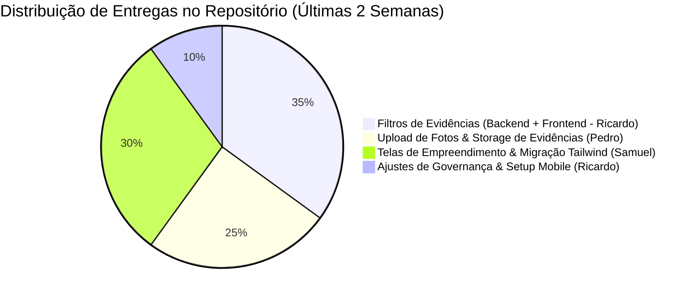

# 📊 Relatório Quinzenal de Atividades do Repositório Constructo
**Período:** 05 de Outubro de 2026 a 19 de Outubro de 2026 (Últimas 2 Semanas)  
**Repositório:** [startups-sg-org/Constructo](https://github.com/startups-sg-org/Constructo)  
**Autor do Relatório:** Ricardo Lopes Tomaz ([@ricardolopestomaz](https://github.com/ricardolopestomaz))  

---

## 🎯 Sumário Executivo

Nas últimas duas semanas, o projeto **Constructo** concentrou-se em dois grandes pilares de desenvolvimento:
1. **Módulo de Gerenciamento de Evidências de Obra:** Implementação de upload de mídia, persistência em storage, metadados, visualização em galeria e, crucialmente, o motor de filtragem hierárquica e temporal.
2. **Evolução e Modernização do Frontend:** Reestruturação de telas de empreendimentos, vinculação de unidades a compradores, migração para Tailwind CSS com `@theme` padronizado e preparação da base mobile (Expo).



---

## 👥 1. O que foi feito no Repositório como um todo (Visão Geral da Equipe)

Durante este período, a equipe trabalhou com alta cadência de commits e merges na branch `develop` e `main`, destacando-se as seguintes entregas:

### 1.1. Módulo de Evidências de Obra
* **Upload e Storage de Mídia:** Criação do serviço de upload de imagens para evidências com armazenamento de metadados técnicos no banco relacional via SQLAlchemy (PRs `#229`, `#230`, `#231` - Pedro Ryan).
* **Vínculo com Marcos e Responsáveis:** Associação de fotos de obra aos marcos do cronograma físico e rastreabilidade de quem realizou a captura.
* **Galeria de Evidências (Base):** Criação da visualização inicial em grid com modal de detalhes da foto.

### 1.2. Módulo de Empreendimentos e Clientes
* **Explorador de Estrutura:** Construção da navegação hierárquica por Torre, Bloco, Pavimento e Unidade no frontend (PR `#245` - Issue `#244`).
* **Vínculo Comprador-Unidade:** Exposição de endpoints HTTP seguros no backend e telas no frontend para vincular clientes a unidades imobiliárias (PRs `#248`, `#249`, `#250`).
* **Planejamento do Módulo de Clientes:** Documentação inicial da jornada do comprador (PR `#204`).

### 1.3. Refatoração Visual do Frontend
* **Adoção do Tailwind CSS:** Migração da estilização legada para Tailwind com definição formal de tokens visuais em `@theme` (`constructo-primaria`, `constructo-fundo-painel`, etc.) e criação de primitives em `apps/web/src/componentes/ui/Ui.tsx`.

---

## 🚀 2. O que EU fiz (Atividades de Ricardo Lopes Tomaz)

Minha atuação concentrou-se na implementação completa (Full Stack) do sistema de **consultas avançadas e filtros de evidências**, na cobertura de testes automatizados, na modelagem técnica do ciclo de vida das evidências e na estruturação do ambiente mobile.

```
┌────────────────────────────────────────────────────────────────────────┐
│               ATUAÇÃO FULL STACK: RICARDO LOPES TOMAZ                  │
├──────────────────────────┬─────────────────────────────────────────────┤
│ 1. Backend (FastAPI)     │ DTOs, filtros em árvore, normalização UTC   │
│ 2. Frontend (React/Vite) │ UI da Galeria, controles dinâmicos de busca │
│ 3. Testes Automatizados  │ 46 testes no backend + 76 no frontend       │
│ 4. Documentação & DTOs   │ Especificação técnica das Issues #223 a #228│
│ 5. Setup Mobile & Design │ Criação de Skill Anti-AI Slop e branch Expo │
└──────────────────────────┴─────────────────────────────────────────────┘
```

---

### 2.1. Implementação dos Filtros de Evidências (Full Stack)
> **Branch:** `feat/filtrar-evidencias`  
> **Commit Principal:** `b7320df` *(13 arquivos alterados, +944 adições, -24 remoções)*  
> **Issues Atendidas:** `#223` (Filtro por Local), `#224` (Filtro por Etapa), `#225` (Filtro por Período).

#### A. Backend (`apps/backend`):
* **Validação Robusta via Pydantic (`schemas.py`):**
  * Criado o esquema `FiltrosEvidencia_Query_Schema` com suporte a `local_obra_id`, `tipo_local`, `incluir_descendentes_local`, `etapa_id`, `incluir_subetapas`, `marco_id`, `data_captura_inicio` e `data_captura_fim`.
  * Validador `@model_validator` impedindo que a data inicial seja superior à final, retornando `HTTP 422 Unprocessable Entity` quando há inconsistência.
* **Algoritmos em Árvore na Camada de Serviço e Repositório (`servicos.py` e `repository.py`):**
  * Desenvolvido algoritmo recursivo para buscar todos os IDs de locais descendentes da obra (`obter_ids_locais_descendentes`), permitindo ao usuário filtrar, por exemplo, um Bloco inteiro e ver as fotos de todas as suas unidades.
  * Resolução em árvore de etapas e subetapas para agregar todos os marcos vinculados (`obter_ids_marcos_por_etapa`).
  * Consultas SQLAlchemy otimizadas com `joinedload` e `selectinload` para evitar o problema de N+1 queries.
  * Normalização obrigatória de fusos horários para UTC.
* **Exposição de Rota HTTP (`routes.py`):**
  * Atualização da rota `GET /empreendimentos/{empreendimento_id}/evidencias` para aceitar os parâmetros de consulta tipados.

#### B. Frontend (`apps/web`):
* **Tipagem TypeScript (`types.ts`):** Interface `FiltrosEvidencia` sincronizada com os DTOs do backend.
* **Serviço de Comunicação (`evidencias.service.ts`):** Montagem dinâmica de `URLSearchParams` para requisições limpas.
* **Interface da Galeria (`EvidenceGallery.tsx` e `EvidenceGallery.css`):**
  * Criação do painel de filtros com inputs para Local, Tipo (`TORRE`, `BLOCO`, `PAVIMENTO`, `UNIDADE`), Etapa, Marco e datas inicial/final.
  * Checkboxes inteligentes para alternar entre busca estrita ou inclusão de descendentes/subetapas.
  * Atualização em tempo real do grid de fotos conforme os filtros são acionados.

---

### 2.2. Garantia de Qualidade e Testes Automatizados

Para certificar que as regras de negócio não gerem regressões, desenvolvi testes ponta a ponta:

| Escopo do Teste | Arquivo de Teste | Qtd. Testes | Status |
| :--- | :--- | :---: | :---: |
| **Filtros de Evidências (Backend)** | `apps/backend/tests/test_pi_evidencias.py` | **46** | ✅ 100% Passando |
| **Backend Geral (Regressão)** | Suíte completa Pytest | **107** | ✅ 100% Passando |
| **Serviço & Galeria (Frontend)** | `EvidenceGallery.test.tsx`, `evidencias.service.test.ts` | **28** | ✅ 100% Passando |
| **Frontend Geral (Vitest)** | Suíte completa Vitest | **76** | ✅ 100% Passando |
| **Tipagem e Linter** | `tsc -b` & `eslint .` | - | ✅ 0 Erros / 0 Warnings |

*Destaque:* No commit `744e14d`, realizei a limpeza e correção de escopo de sessão do banco de dados na suíte de testes do backend para garantir idempotência.

---

### 2.3. Especificação Técnica e Modelagem de DTOs

Além do código, atuei na documentação da arquitetura do projeto:
1. **`docs/dtos-filtros-evidencias.md`:** Especificação formal com payloads JSON, query params e diagramas de fluxo das issues `#223`, `#224` e `#225`.
2. **`docs/dtos-gestao-evidencias.md`:** Especificação arquitetural com ciclo de vida das evidências (Pendente ➔ Válida / Inválida ➔ Removida) para as issues seguintes:
   * Issue `#226`: Remoção física e lógica de evidências.
   * Issue `#227`: Fluxo de aprovação/rejeição com motivo pelo gestor.
   * Issue `#228`: Visualizador rico com zoom e metadados EXIF.
3. **`docs/PULL_REQUEST_DESCRICAO.md`:** Modelo detalhado de entrega para revisão do time.

---

### 2.4. Governança e Início do Mobile (19/10/2026)
* **Ajustes no Repositório Principal (`main`):**
  * Submissão e merge dos PRs `#257` e `#258` corrigindo a documentação do projeto e metadados no `README.md`.
* **Design System Mobile & Prevenção de "AI Slop" (`.antigravity/skills/ui-craft.md`):**
  * Criação de diretrizes estéticas e física de mola com `react-native-reanimated` para o app Expo.
  * Mapeamento dos tokens `@theme` do Constructo (`#236557`, `#F5F7F6`, `#B97200`) e técnica dos componentes primitivos trancados.
* **Nova Branch Mobile:** Criação da branch `feat/mobile-app` para iniciar a construção das telas nativas.

---

## 📋 Resumo em Tabela para Apresentação Rápida

| Área | Entregas Realizadas por Ricardo | Impacto / Benefício |
| :--- | :--- | :--- |
| **Backend** | Query DTOs, busca recursiva em árvore e validação UTC | Permite localizar fotos de qualquer ponto da obra ou fase do cronograma com segurança |
| **Frontend** | Painel de filtros na Galeria de Evidências em React | Engenheiros e gestores conseguem auditar o progresso visual de forma segmentada |
| **Qualidade** | 46 testes no backend + testes unitários no frontend | Zero quebras nas regras de negócio e estabilidade para o deploy |
| **Arquitetura** | Documentos de DTOs (`dtos-filtros` e `dtos-gestao`) | Padronização dos contratos de API entre frontend e backend |
| **Mobile** | Skill `ui-craft.md` e branch `feat/mobile-app` | Estabelece as bases para o aplicativo mobile sem vícios visuais genéricos |
